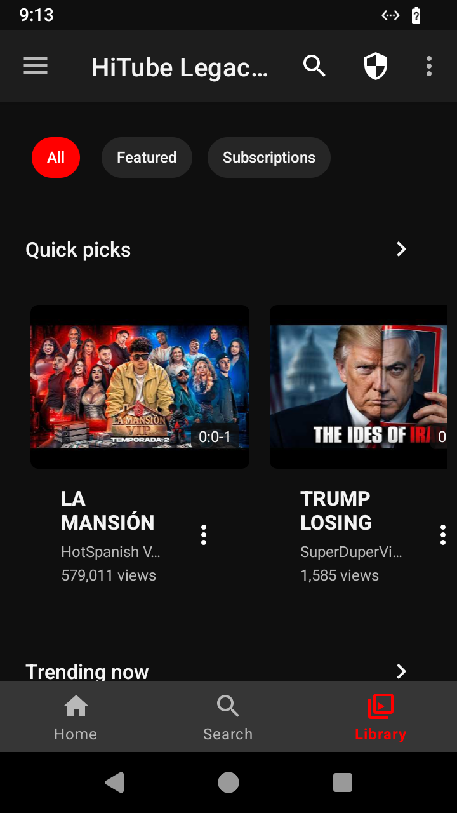
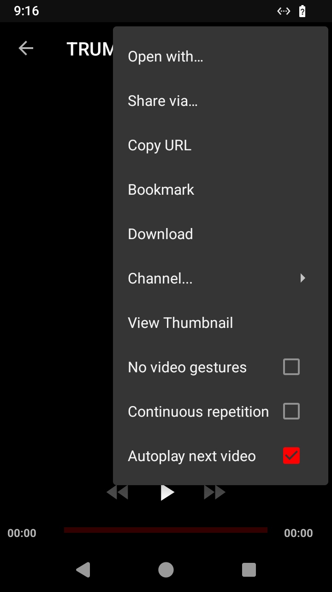
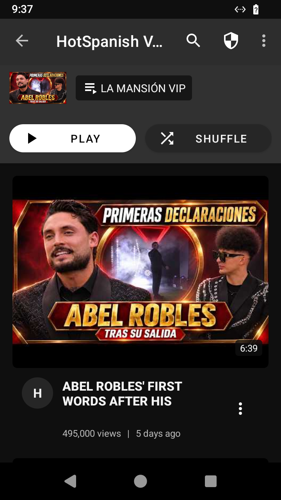
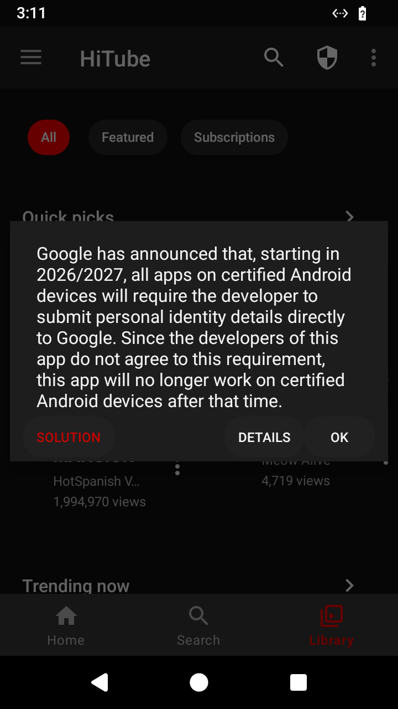
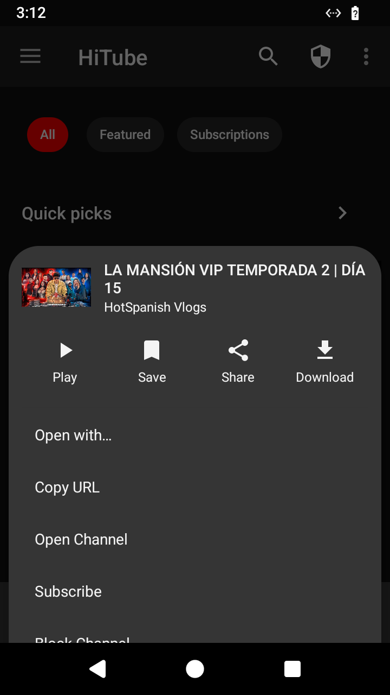
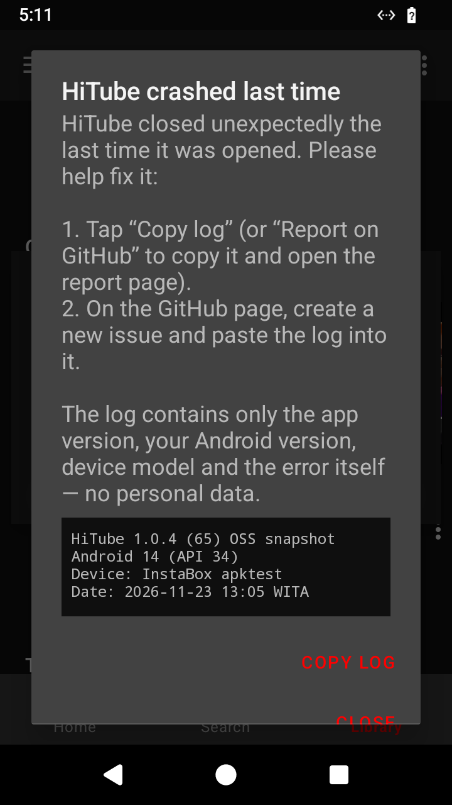

# HiTube Legacy
**A copylefted libre / open source YouTube player for Android, without ads — with a fresh UI.**

🌐 **Website:** https://arazharr.github.io/hitube-legacy/

## About this redesign

HiTube Legacy is based on **SkyTube Legacy** by **SkyTubeTeam** —
https://github.com/SkyTubeTeam/SkyTubeLegacy — released under the
**GNU General Public License v3.0 (GPL-3.0)**. All credit for the original
code, features and years of hard work goes to the SkyTubeTeam and its
contributors (see [NOTICE](NOTICE) and the `LICENSE` file).

This redesign gives SkyTube Legacy a **fresh UI**: a new, modern look
following modern Material 3 guidelines — a dark theme with a red accent,
clean surfaces, rounded thumbnails and cards, and a consistent type scale.
Nothing else changed: **all features are kept exactly as they were**, and
the app still supports old Android devices (**minSdk 14 / Android 4.0+**).
The application ID (`free.rm.skytube.legacy`) is unchanged.

  <a href="#features">Features</a> |
  <a href="#download">Download</a> |
  <a href="#why-hitube-legacy">Why HiTube Legacy?</a> |
  <a href="#screenshots">Screenshots</a> |
  <a href="#contribute">Contribute</a> |
  <a href="#license">License</a>

## Features
### Innovative Features
* Video blocker featuring:
  - Channel blacklisting
  - Channel whitelisting
  - Block videos if their language is not the same as the user's preferred one(s)
  - Block low-view videos
  - Block high-dislike videos
  - Toolbar icon showing number of blocked videos
* Watched or partially watched videos are marked accordingly. "Resume playing" feature also implemented
* In-app mini player — keep watching while you browse
* Background playback — audio keeps playing when you leave the app, with controls in the notification
* Autoplay next video, with a toggle right inside the player
* Double-tap to seek ±5 seconds, YouTube-style
* If the app crashes, the crash log is shown on the next launch — copy it or report it on GitHub
* Video swipe controls for volume, comments and video description
* Bookmark videos
* Import subscriptions from YouTube
* Play channels' playlists
* Download videos
* Ability to play the video faster — or slower than live.
* View and download video thumbnails
* No adverts when browsing or playing videos
* SponsorBlock to skip advertisement segments
* Back up and restore bookmarks and subscriptions (all stored locally on your device)

### Traditional Features
* Explore Featured and Most Popular videos
* Browse YouTube channels
* Play YouTube videos
* View video comments
* Search videos, music and channels
* Channel subscription

More features will be added in the near future.

## Requirements
Android 4.0 (Ice Cream Sandwich) or later. For techies, that means an API level of 14 or greater.

## Download
Get the latest release from the [Releases page](https://github.com/AraZharr/hitube-legacy/releases). Each release includes five APKs (for example, for v1.0.5):

* `hitube-legacy-Legacy-Oss-1.0.5-arm64-v8a.apk` — most modern phones (64-bit ARM), including most phones from 2015 onwards
* `hitube-legacy-Legacy-Oss-1.0.5-armeabi-v7a.apk` — older 32-bit ARM phones
* `hitube-legacy-Legacy-Oss-1.0.5-x86.apk` / `hitube-legacy-Legacy-Oss-1.0.5-x86_64.apk` — Intel-based devices and emulators
* `hitube-legacy-Legacy-Oss-1.0.5.apk` — universal APK, works on every device; pick this one if you are unsure

All five contain the same app — the split files only exist so you can pick the one matching your device.

| Flavor | Description |
| ------ | ----------- |
| HiTube (OSS) | Fully open-source and free software. This is the main flavor. |
| Extra | Extra flavor with the official YouTube player and Chromecast support, powered by a closed-source, third-party library. |

## Why HiTube Legacy?
* Copylefted libre software
* Gratis
* Fresh, modern design
* No ads
* Multilingual
* Not dependent on GApps/Google Apps (the official YouTube app)
* No need for Google/YouTube account to operate
* Does not spy on your behaviour!

## Screenshots
### Phone

## Contribute
Contributions are welcome — open an issue or a pull request in this repository.

This project is based on SkyTube Legacy by SkyTubeTeam; the original code was made possible by the support and contribution of [numerous volunteers and third-party projects](http://skytube-app.com/credits.html).

## Star History

## License

HiTube Legacy is free software, licensed under the GNU General Public
License v3.0 (GPL-3.0) — see the `LICENSE` file and the [NOTICE](NOTICE)
for attribution. The original code is SkyTube Legacy by SkyTubeTeam
(https://github.com/SkyTubeTeam/SkyTubeLegacy); this redesign keeps the
same license.

This project is not affiliated with YouTube™ or any of its partners and/or products.
YouTube™ and Android™ are registered trademarks of Google Inc.
